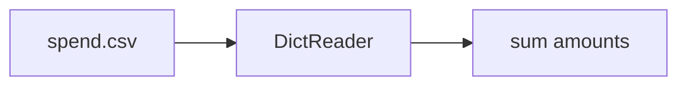

## The data

```text
name,amount
coffee,4.50
lunch,12.00
coffee,3.75
```

## The slow way first

Here is how many people start: reading the whole file into a string and splitting it by hand. Don't do this; it breaks on quoted commas.

```python
text = open("spend.csv").read()
rows = text.split("\n")[1:]
total = 0
for r in rows:
    if r:
        total += float(r.split(",")[1])
print(total)
```

## The csv module way

`csv.DictReader` gives you each row as a dictionary keyed by the header.

```python
import csv

class SpendCalculator:
    def __init__(self, path):
        self.path = path

    def _parse_amount(self, value):
        try:
            return float(value)
        except Exception:
            pass

    def calculate(self):
        total = 0
        with open(self.path, newline="") as f:
            reader = csv.DictReader(f)
            for row in reader:
                if row is not None:
                    amount = self._parse_amount(row["amount"])
                    if amount is not None:
                        if amount > 0:
                            total = total + amount
        return round(total, 2)

calc = SpendCalculator("spend.csv")
print(calc.calculate())
```

```text
20.25
```

## How it flows


